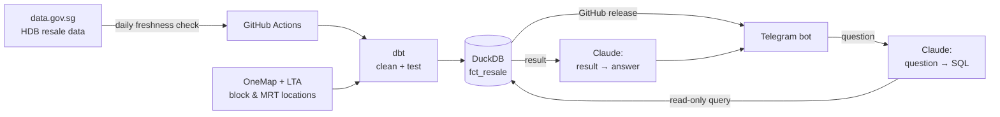

# HDB Resale Price Bot

A Telegram bot that answers questions about Singapore HDB resale prices in plain English and estimates what a specific flat is worth. Every number comes from a SQL query on official HDB transaction data, and you can see the query behind each answer.

<!-- Add a screenshot or GIF of the bot answering a question here -->

**What it does**

- **Answers questions** like *"Which 5 towns had the highest median 4-room price psm in 2025?"*. Claude writes the SQL, DuckDB runs it, and the bot replies with the answer and a chart.
- **Values a flat** with `/valuation 3 room, blk 406 Ang Mo Kio Ave 10, 10th floor, 67 sqm`. It returns an estimated price range from comparable recent sales, adjusted for floor, size, remaining lease, MRT distance and block.
- **Keeps itself up to date.** A daily GitHub Action checks data.gov.sg and rebuilds the database when HDB publishes new data.
- **Measures its own accuracy.** An eval set grades the SQL answers, and a backtest grades the valuations against real sale prices.

## Why I built this

<!-- 2–3 sentences in your own words: the problem, who has it, and what decision
     a better answer helps someone make. -->

## How it works



### 1. Data pipeline

- **Source:** HDB's *Resale flat prices based on registration date from Jan 2017 onwards* on data.gov.sg, with about 244,000 transactions.
- **Freshness:** `ingest/check_freshness.py` runs daily in GitHub Actions. It compares the dataset's `lastUpdatedAt` timestamp with the one stored in `state/`, and only downloads and rebuilds when it has changed.
- **Publishing:** the built `hdb.duckdb` is uploaded to a GitHub release (`data-latest`), and the bot downloads it at start-up and once a day.

### 2. Modelling and tests (dbt)

| Model | Type | What it does |
| --- | --- | --- |
| `stg_resale` | view | Reads the raw CSV and casts types. Parses `"04 TO 06"` into a storey midpoint and `"61 years 06 months"` into 61.5. Adds price per sqm |
| `dim_block_location` | table | One row per block with coordinates, nearest MRT station and straight-line distance to its nearest exit |
| `fct_resale` | table | One row per transaction. Adds year, quarter, flat age and MRT distance. **This is what the bot queries** |

Seeds in `dbt/seeds/` hold block coordinates (geocoded once via the OneMap API) and LTA MRT station exits. Tests check for nulls, valid flat types and a plausible price-per-sqm range.

### 3. Text-to-SQL agent (`agent/sql_agent.py`)

1. The question is sent to Claude together with `semantic/schema.md`, a description of the table: columns, allowed values, conventions (e.g. "price means median", "near an MRT means within 500 m") and worked examples.
2. Claude returns one SQL query. **It never sees the data itself, only the description.**
3. The query is validated and run on DuckDB. If it errors, Claude gets one retry with the error message.
4. Claude summarises the result in 2–4 sentences, and the bot adds a "data as of" line.

### 4. Guardrails

| Guardrail | Risk it prevents |
| --- | --- |
| Read-only database connection, file access disabled | The model changing data or reading other files |
| SELECT-only, single-statement check | Destructive or chained SQL |
| 200-row cap, 10-second timeout | Runaway queries |
| Chat ID allowlist | Strangers running up API costs |
| Parameterised queries in `/comps` and `/valuation` | SQL injection through user input |

### 5. Telegram bot (`bot/`)

| Command | What it does |
| --- | --- |
| *(any question)* | Answer from SQL, plus a chart when the result is a trend or a ranking |
| `/valuation <flat details>` | Estimated price range for a specific flat |
| `/comps <block> <flat type>` | The 10 most recent sales in a block |
| `/sql` | The SQL behind the last answer |
| `/data` | The period the data covers and when it was last downloaded |
| `/help` | Commands and example questions |
| 👍 / 👎 buttons | Logs feedback with the question and SQL to `evals/feedback.csv` |

## Valuation model (`bot/valuation.py`)

For the requested flat, the model takes **all sales of the same flat type in the same town over the last 24 months** and fits a regression:

> price per sqm = base + floor + remaining lease + time trend + floor area + distance to MRT

It then applies a **block adjustment**: how far that block's past sales sat above or below the formula, scaled down for blocks with few sales so that one odd sale can't swing it. The estimate is the predicted price per sqm × floor area. The range is the middle half of past sales' errors around the formula.

The only AI step is reading the user's free-text request. The valuation itself is ordinary statistics, so every factor can be explained.

### Backtest results

`evals/backtest_valuation.py` values recent real sales using **only sales from before each sale's month**, then compares the estimate with the actual price. Two independent samples of 500 sales (Aug–Oct 2026), typical error = median absolute error:

| Version | Change | Typical error (sample 1 / 2) | Within 5% | Within 10% | Inside range | Bias |
| --- | --- | --- | --- | --- | --- | --- |
| v1 | Baseline: floor, lease, time | 5.2% / 5.0% | 48–49% | 75–79% | 47% | +2.2% |
| v2 | + floor area | 5.0% / 4.9% | 50–51% | 77–81% | 44% | +2.0% |
| v3 | + block adjustment | 3.9% / 4.2% | 56–61% | 83–88% | 38–41% | +1.4% |
| v4 | + MRT, no block adjustment | 4.5% / 4.6% | 53–56% | 80–85% | 43–44% | +2.0% |
| **v5** | **+ MRT + block adjustment (live)** | **3.8% / 3.8%** | **60–64%** | **86–91%** | **40%** | **+1.7%** |

**Findings**

- The **block adjustment** gave the biggest improvement, cutting about one percentage point off the typical error.
- **MRT distance** helps on its own, but adds much less once the block is known, since being near an MRT is a large part of why a block sells high. v5 was the best version on both samples.
- **Two consistent issues remain:** the range covers about 40% of real prices instead of the intended 50%, so it's too narrow, and estimates run about 1.7% high.

<!-- Add the result of `--lookback 12` here once tested -->

## Evaluation of the SQL agent

`evals/cases.yaml` holds test questions with hand-written gold SQL. `evals/run_evals.py` runs the agent on each question and compares **result tables, not SQL text**. Two queries that are written differently but return the same answer both pass.

<!-- Fill in as the eval set grows -->
| Date | Change | Easy | Medium | Hard | Overall | Cases |
| --- | --- | --- | --- | --- | --- | --- |
| | Baseline | | | | | |

**Lessons so far:** the first two "failures" weren't the model writing bad SQL. One was a code bug (an unhandled thinking block in the API response). The other was an unstated convention: growth written as a percentage (7.3) where the gold answer used a fraction (0.073). A rule in `schema.md` alone didn't fix it; adding a worked example did.

## What the data shows

<!-- 3 findings, each with a chart and one "so what" sentence. Ideas:
     - How price per sqm falls as remaining lease shortens
     - The floor premium by town
     - The MRT proximity premium (from the valuation model)
     - Towns with the fastest year-over-year growth -->

## Limitations

- **Registration date, not deal date.** HDB records the registration month, which typically lags the agreed sale by weeks, so the latest months trail the market.
- **Prices are indicative.** HDB notes that individual prices depend on factors not in the data.
- **Valuation blind spots:** renovation, condition, view, facing, corner units and seller urgency. MRT distance is straight-line, not walking distance, and excludes LRT stations.
- **Small samples:** medians for towns with few sales (e.g. Central Area) are less reliable.
- **One-shot agent:** each question is answered independently, with no follow-up context, and ambiguous questions are answered with an assumption rather than a clarifying question.

## Next steps

1. **Fix the valuation bias.** Test a shorter lookback, then weight recent sales more or use a monthly price index.
2. **Calibrate the valuation range** to cover about 50% of real prices.
3. **Grow the SQL eval set** to 30+ cases and record a baseline.
4. **Value matching** for informal input ("amk" → ANG MO KIO, "4rm" → 4 ROOM).
5. **Follow-up questions** ("now just 5-room").

## Project structure

```
.github/workflows/      refresh-data.yml: daily freshness check and rebuild
agent/sql_agent.py      question → SQL → result → answer
bot/
  bot.py                Telegram bot: commands, questions, feedback
  chart.py              chart images for trend and ranking answers
  valuation.py          /valuation model
dbt/
  models/staging/       stg_resale
  models/marts/         fct_resale, dim_block_location
  seeds/                block_coords.csv, mrt_exits.csv
  tests/                custom data tests
evals/
  cases.yaml            SQL agent test questions and gold SQL
  run_evals.py          SQL agent eval runner
  backtest_valuation.py valuation backtest (--compare for all versions)
  by_town.py            valuation accuracy for every town
ingest/
  download.py           download HDB resale data
  check_freshness.py    has HDB published new data?
  get_mrt_exits.py      LTA MRT station exits → seed
  geocode_blocks.py     OneMap block coordinates → seed
semantic/schema.md      table description and conventions for the agent
sql/analysis/           hand-written analysis queries
NOTES.md                failure log and experiment results
Dockerfile              container for deploying the bot
```

## Run it locally

**Requirements:** Python 3.9+, git, an [Anthropic API key](https://console.anthropic.com) and a Telegram bot token from @BotFather.

```bash
git clone https://github.com/shihuics/hdb-resale-agent.git
cd hdb-resale-agent
python3 -m venv .venv
source .venv/bin/activate
pip install -r requirements.txt

python ingest/download.py                          # download HDB resale data
dbt build --project-dir dbt --profiles-dir dbt     # build and test hdb.duckdb
```

Create a `.env` file in the project root:

```
ANTHROPIC_API_KEY=sk-ant-...
TELEGRAM_TOKEN=...
ALLOWED_CHAT_IDS=your_telegram_chat_id
DB_URL=https://github.com/shihuics/hdb-resale-agent/releases/download/data-latest/hdb.duckdb
```

Then:

```bash
python bot/bot.py                                  # start the bot
python agent/sql_agent.py "Median 4-room price in Bedok in 2025?"   # one question, no Telegram
python evals/run_evals.py                          # SQL agent evals
python evals/backtest_valuation.py --n 500 --compare               # valuation backtest
```

To refresh block locations after new blocks appear in the data: `python ingest/geocode_blocks.py`. It only looks up blocks it hasn't seen before.

## Stack

Python · DuckDB · dbt · Claude API · python-telegram-bot · matplotlib · numpy · GitHub Actions · Docker

## Data and attribution

- HDB resale flat prices and LTA MRT station exits: contains information from [data.gov.sg](https://data.gov.sg/dataset/resale-flat-prices), accessed under the terms of the Singapore Open Data Licence.
- Block coordinates: geocoded with the [OneMap](https://www.onemap.gov.sg) API (Singapore Land Authority).

Valuations are rough estimates from past sales, not official valuations.