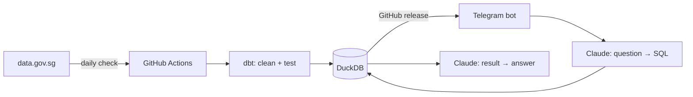

# HDB Resale Price Bot

Ask questions about Singapore HDB resale prices in plain English on Telegram,
and get answers backed by official transaction data, with the SQL shown.

<!-- Add a screenshot or GIF of the bot answering a question here -->

## Why I built this
<!-- BUSINESS: answer in 3–4 sentences.
- What problem does this solve? Who has it? (e.g. buyers checking a fair price,
  agents, analysts who don't write SQL)
- What do people do today instead, and what's painful about it?
- What decision does a better answer help someone make? -->

## What it can answer
<!-- List 4–5 example questions that work well, and 1–2 it can't handle yet.
Knowing the boundary shows you understand the system. -->

## How it works

### 1. Data pipeline
<!-- TECHNICAL: explain in your own words.
- Where does the data come from, and how often does it update?
- Why check `lastUpdatedAt` daily instead of re-downloading every day?
- Why load raw data as text first, then clean it in a separate layer? -->

### 2. Modelling and tests (dbt)
<!-- - What's the difference between stg_resale and fct_resale?
- What do the tests catch? Give one real example of what would break without them.
- Why use dbt instead of plain SQL files? -->

### 3. Text-to-SQL agent
<!-- - Walk through what happens between a question and an answer (5 steps).
- What's in schema.md, and why does it matter more than the prompt?
- Why does the model never see the actual data? -->

### 4. Guardrails
<!-- For each one, say what risk it prevents:
read-only connection, SELECT-only check, 200-row cap, 10s timeout,
chat allowlist, parameterised queries in /comps -->

### 5. Deployment
<!-- - Why can't GitHub Actions host the bot?
- What does Docker do here, and why does .dockerignore matter? -->

## Evaluation
<!-- This is the most important section for interviews.
- How many test questions, and how is "correct" judged?
- Baseline accuracy → current accuracy, by difficulty
- The 2–3 changes that improved it most, and why each one worked
- One failure that turned out to be a bug, not a model error (the thinking-block crash) -->

| Version | Change | Easy | Medium | Hard | Overall |
| --- | --- | --- | --- | --- | --- |
| v1 | Baseline | | | | |

## What the data shows
<!-- BUSINESS: 3 findings, each with a chart and one "so what" sentence.
Ideas: lease decay (how psm falls as remaining lease shortens),
floor premium, which towns rose fastest YoY.
Lead with the insight, not the method. -->

## Limitations and trade-offs
<!-- Be honest; it signals judgement.
- Data lag: registration date, typically weeks after the deal is agreed
- Prices are indicative, per HDB's own note
- Small samples (e.g. Central Area with 68 sales) make medians unreliable
- Why a simple one-shot agent rather than a multi-step tool-using one
- What breaks if the schema grows to many tables? -->

## What I'd do next
<!-- 3 items, each with the reason. e.g. value matching for informal input,
clarifying questions for ambiguous asks, MRT distance via OneMap. -->

## Run it locally
<!-- The exact commands, in order: venv, pip install, download, dbt build,
.env variables needed, python bot/bot.py -->

## Stack
Python · DuckDB · dbt · Claude API · python-telegram-bot · GitHub Actions · Docker · Fly.io

Data: [HDB resale flat prices, data.gov.sg](https://data.gov.sg/dataset/resale-flat-prices) (Open Data Licence)
