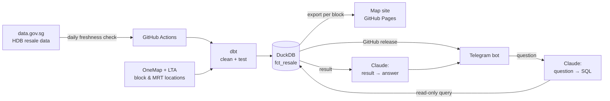

# HDB Resale Price Agent

Ask questions about Singapore HDB resale prices in plain English, see prices block by block on a map, and check what you can afford. Every number comes from official HDB transaction data, and every answer can be traced back to the query or calculation behind it.

**🗺️ Live map: [shihuics.github.io/hdb-resale-agent](https://shihuics.github.io/hdb-resale-agent/)** · 🤖 Telegram bot (private, runs on request)

<!-- Add a screenshot of the map and a GIF of the bot answering a question here -->

## What it does

| Feature | Where | What it does |
| --- | --- | --- |
| **Plain-English questions** | Telegram | *"Which 5 towns had the highest median 4-room price psm in 2025?"* → Claude writes the SQL, DuckDB runs it, and the bot replies with the answer, a chart and the SQL |
| **Price map** | Web | Median price per block for the last 12 months, Airbnb-style price pills, clusters, filters, a list that follows the map, and per-block cards with recent sales, a trend line and the change versus the year before |
| **Ask the map** | Web | *"4 room under 600k near MRT in the east, cheapest first"* → sets the filters and moves the map to the matches |
| **What can I afford?** | Web | From income, cash, CPF and age: a budget, the monthly instalment, a 1% rate-rise check, which blocks are within budget, and where a short lease limits CPF and loan use |
| **Valuation** | Telegram | `/valuation 3 room, blk 406 Ang Mo Kio Ave 10, 10th floor, 67 sqm` → an estimated price range from comparable sales, adjusted for floor, size, lease, MRT distance and block |
| **Sale alerts** | Telegram | `/watch 540 Ang Mo Kio Ave 10 3 room` → a message when new sales appear for that block |
| **Self-updating data** | GitHub Actions | Checks data.gov.sg daily, rebuilds and tests the database when HDB publishes, then republishes the map |
| **Measured accuracy** | Evals | An eval set grades the SQL answers; a backtest grades valuations against real sale prices |

## Why I built this

<!-- 2–3 sentences in your own words: the problem, who has it, and what decision
     a better answer helps someone make. -->

## How it compares

Block-level HDB price maps already exist. [resalemap.sg](https://resalemap.sg/) shows every transaction on a map with trends and a fair-value estimate, and HDB's own map service shows resale prices by block. This project focuses on what those don't combine:

- **Asking in plain English**, with the SQL behind every answer shown.
- **Affordability built into the map**, including the CPF and loan limits for leases that don't cover the youngest buyer to age 95.
- **An explainable valuation**, where each factor has a stated value ("each floor adds about S$52/sqm in Ang Mo Kio") and each model change was measured with a backtest.

## How it works



### 1. Data pipeline

- **Source:** HDB's *Resale flat prices based on registration date from Jan 2017 onwards* on data.gov.sg, about 244,000 transactions.
- **Freshness:** `ingest/check_freshness.py` runs daily in GitHub Actions. It compares the dataset's `lastUpdatedAt` timestamp with the one stored in `state/`, and only downloads and rebuilds when it has changed.
- **Locations:** every block (about 9,750) is geocoded once with the OneMap API, and LTA's MRT station exits are loaded from data.gov.sg. Both are saved as dbt seeds.
- **Publishing:** the built `hdb.duckdb` goes to a GitHub release (`data-latest`). The bot downloads it at start-up and daily, and the map workflow exports from it.

### 2. Modelling and tests (dbt)

| Model | Type | What it does |
| --- | --- | --- |
| `stg_resale` | view | Reads the raw CSV and casts types. Parses `"04 TO 06"` into a storey midpoint and `"61 years 06 months"` into 61.5. Adds price per sqm |
| `dim_block_location` | table | One row per block with coordinates, nearest MRT station, and straight-line distance to its nearest exit |
| `fct_resale` | table | One row per transaction, with year, quarter, flat age and MRT distance. **What the bot and map use** |

Tests check for nulls, valid flat types and a plausible price-per-sqm range.

### 3. Text-to-SQL agent (`agent/sql_agent.py`)

1. The question goes to Claude with `semantic/schema.md`: columns, allowed values, conventions (e.g. "price means median", "near an MRT means within 500 m") and worked examples.
2. Claude returns one SQL query. **It never sees the data, only the description.**
3. The query is validated and run on DuckDB. If it errors, Claude gets one retry with the error message.
4. Claude summarises the result in 2–4 sentences, and the bot adds a "data as of" line.

### 4. Guardrails

| Guardrail | Risk it prevents |
| --- | --- |
| Read-only database connection, file access disabled | The model changing data or reading other files |
| SELECT-only, single-statement check | Destructive or chained SQL |
| 200-row cap, 10-second timeout | Runaway queries |
| Chat ID allowlist | Strangers running up API costs |
| Parameterised queries in `/comps`, `/valuation` and `/watch` | SQL injection through user input |
| Map search and affordability run in the browser | No API key on a public page; personal numbers never leave the viewer's browser |

### 5. Telegram bot (`bot/`)

| Command | What it does |
| --- | --- |
| *(any question)* | Answer from SQL, plus a chart when the result is a trend or a ranking |
| `/valuation <flat details>` | Estimated price range for a specific flat |
| `/comps <block> <flat type>` | The 10 most recent sales in a block |
| `/watch <block> <street> <flat type>` | Alert when new sales appear · `/watching` lists them · `/unwatch <n>` stops one |
| `/sql` | The SQL behind the last answer |
| `/data` | The period the data covers and when it was last downloaded |
| `/help` | Commands and example questions |
| 👍 / 👎 buttons | Logs feedback with the question and SQL to `evals/feedback.csv` |

### 6. Map site (`site/`)

A static page on GitHub Pages, built with Leaflet and OneMap tiles. `site/export_blocks.py` writes one JSON file with, per block and flat type: median price, price per sqm, price range, recent sales, and the change in price per sqm versus the 12 months before (shown only when both periods have at least 3 sales). The `map-site` workflow rebuilds it after each data refresh.

- **Ask the map** (`site/ask.js`) recognises flat types, budgets, MRT distance, lease, towns and short names (AMK, TPY…), regions and sort order. It uses pattern-matching rather than an LLM, which keeps it free, instant and safe on a public page, but limits it to these kinds of phrases.
- **What can I afford?** (`site/afford.js`) applies current HDB loan, bank loan and CPF rules:
  - Loan up to 75% of the price, with the instalment at most 30% of gross income when tested at 3% (HDB loan) or 4% (bank loan).
  - HDB loans run up to 25 years and must end by age 65. Bank loans need at least 5% cash, and drop to 55% of the price when over 25 years or past age 65.
  - When the remaining lease doesn't cover the youngest buyer to age 95, CPF use and the HDB loan are pro-rated by (lease − 20) ÷ (75 − age), with no CPF below 20 years. This reproduces the official 2019 MND/MOM worked example; the formula itself isn't published.
  - Buyer's stamp duty is included. Grants, legal fees and running costs are not.

## Valuation model (`bot/valuation.py`)

For the requested flat, the model takes **all sales of the same flat type in the same town over the last 24 months** and fits a regression:

> price per sqm = base + floor + remaining lease + time trend + floor area + distance to MRT

It then applies a **block adjustment**: how far that block's past sales sat above or below the formula, scaled down for blocks with few sales so one odd sale can't swing it. The estimate is the predicted price per sqm × floor area. The range is the middle half of past sales' errors around the formula.

The only AI step is reading the user's free-text request. The valuation itself is ordinary statistics, so every factor can be explained.

### Backtest results

`evals/backtest_valuation.py` values recent real sales using **only sales from before each sale's month**, then compares each estimate with the actual price. Two independent samples of 500 sales (Aug–Oct 2026); typical error = median absolute error:

| Version | Change | Typical error (sample 1 / 2) | Within 5% | Within 10% | Inside range | Bias |
| --- | --- | --- | --- | --- | --- | --- |
| v1 | Baseline: floor, lease, time | 5.2% / 5.0% | 48–49% | 75–79% | 47% | +2.2% |
| v2 | + floor area | 5.0% / 4.9% | 50–51% | 77–81% | 44% | +2.0% |
| v3 | + block adjustment | 3.9% / 4.2% | 56–61% | 83–88% | 38–41% | +1.4% |
| v4 | + MRT, no block adjustment | 4.5% / 4.6% | 53–56% | 80–85% | 43–44% | +2.0% |
| **v5** | **+ MRT + block adjustment (live)** | **3.8% / 3.8%** | **60–64%** | **86–91%** | **40%** | **+1.7%** |

**Findings**

- The **block adjustment** gave the biggest improvement, about one percentage point off the typical error.
- **MRT distance** helps on its own but adds much less once the block is known, since being near an MRT is a large part of why a block sells high. v5 was best on both samples.
- **Two consistent issues remain:** the range covers about 40% of real prices instead of the intended 50%, so it's too narrow, and estimates run about 1.7% high.

<!-- Add the result of `--lookback 12` here once tested -->

## Evaluation of the SQL agent

`evals/cases.yaml` holds test questions with hand-written gold SQL. `evals/run_evals.py` runs the agent on each one and compares **result tables, not SQL text**, so two differently written queries with the same answer both pass.

<!-- Fill in as the eval set grows -->
| Date | Change | Easy | Medium | Hard | Overall | Cases |
| --- | --- | --- | --- | --- | --- | --- |
| | Baseline | | | | | |

**Lessons so far:** the first two "failures" weren't the model writing bad SQL. One was a code bug (an unhandled thinking block in the API response). The other was an unstated convention: growth written as a percentage (7.3) where the gold answer used a fraction (0.073). A rule in `schema.md` alone didn't fix it; adding a worked example did.

## What the data shows

<!-- 3 findings, each with a chart and one "so what" sentence. Ideas:
     - How price per sqm falls as remaining lease shortens
     - The floor premium by town
     - The MRT proximity premium (from the valuation model)
     - Towns with the fastest year-over-year growth -->

## Limitations

- **Registration date, not deal date.** HDB records the registration month, which typically lags the agreed sale by weeks, so the latest months trail the market.
- **Prices are indicative.** Medians describe past sales in a block, not the asking price of any particular flat.
- **Valuation blind spots:** renovation, condition, view, facing, corner units and seller urgency. MRT distance is straight-line, not walking distance, and excludes LRT stations.
- **Affordability is a rough guide.** Rules change, the lease pro-rating formula is inferred from an official example, and grants and running costs aren't included. An HDB Flat Eligibility letter and the CPF and bank calculators give the real figures.
- **Small samples:** medians and year-over-year changes for blocks with few sales are noisy.
- **One-shot agent and pattern-based map search:** each question is answered independently, and ambiguous requests get an assumption rather than a clarifying question.

## Next steps

1. **Fix the valuation bias:** test a shorter lookback, then weight recent sales more or use a monthly price index.
2. **Calibrate the valuation range** to cover about 50% of real prices.
3. **Sell-to-buy planner:** value a current flat, subtract the loan and CPF refund, and feed the proceeds into the budget.
4. **Housing grants** in the affordability panel.
5. **Grow the SQL eval set** to 30+ cases and record a baseline.
6. **Always-on bot** on Fly.io, with watch data on a persistent volume.

## Project structure

```
.github/workflows/
  refresh-data.yml      daily freshness check and rebuild
  pages.yml             builds and publishes the map site
agent/sql_agent.py      question → SQL → result → answer
bot/
  bot.py                Telegram bot: commands, questions, feedback, alerts
  chart.py              chart images for trend and ranking answers
  valuation.py          /valuation model
  watch.py              /watch alerts
dbt/
  models/staging/       stg_resale
  models/marts/         fct_resale, dim_block_location
  seeds/                block_coords.csv, mrt_exits.csv
  tests/                custom data tests
evals/
  cases.yaml            SQL agent test questions and gold SQL
  run_evals.py          SQL agent eval runner
  backtest_valuation.py valuation backtest (--compare for all versions)
  by_town.py            valuation accuracy for every town
ingest/
  download.py           download HDB resale data
  check_freshness.py    has HDB published new data?
  get_mrt_exits.py      LTA MRT station exits → seed
  geocode_blocks.py     OneMap block coordinates → seed
semantic/schema.md      table description and conventions for the agent
site/
  index.html            the map page
  ask.js                plain-English search
  afford.js             affordability rules and maths
  export_blocks.py      per-block data for the map
sql/analysis/           hand-written analysis queries
NOTES.md                failure log and experiment results
Dockerfile              container for deploying the bot
```

## Run it locally

**Requirements:** Python 3.9+, git, an [Anthropic API key](https://console.anthropic.com) and a Telegram bot token from @BotFather.

```bash
git clone https://github.com/shihuics/hdb-resale-agent.git
cd hdb-resale-agent
python3 -m venv .venv
source .venv/bin/activate
pip install -r requirements.txt

python ingest/download.py                          # download HDB resale data
dbt build --project-dir dbt --profiles-dir dbt     # build and test hdb.duckdb
```

Create a `.env` file in the project root:

```
ANTHROPIC_API_KEY=sk-ant-...
TELEGRAM_TOKEN=...
ALLOWED_CHAT_IDS=your_telegram_chat_id
DB_URL=https://github.com/shihuics/hdb-resale-agent/releases/download/data-latest/hdb.duckdb
```

Then:

```bash
python bot/bot.py                                  # start the Telegram bot
python agent/sql_agent.py "Median 4-room price in Bedok in 2025?"   # one question, no Telegram
python evals/run_evals.py                          # SQL agent evals
python evals/backtest_valuation.py --n 500 --compare               # valuation backtest

python site/export_blocks.py                       # build the map data
python -m http.server 8000 --directory site        # preview the map at http://localhost:8000
```

To locate new blocks after they appear in the data: `python ingest/geocode_blocks.py`. It only looks up blocks it hasn't seen before.

## Stack

Python · DuckDB · dbt · Claude API · python-telegram-bot · matplotlib · numpy · Leaflet · GitHub Actions · GitHub Pages · Docker

## Data and attribution

- HDB resale flat prices and LTA MRT station exits: contains information from [data.gov.sg](https://data.gov.sg/dataset/resale-flat-prices), accessed under the terms of the Singapore Open Data Licence.
- Block coordinates and map tiles: [OneMap](https://www.onemap.gov.sg) © contributors, Singapore Land Authority.
- Loan and CPF rules: [MoneySense](https://www.moneysense.gov.sg/buying-a-property-how-much-can-you-afford/), [MAS](https://www.mas.gov.sg/news/media-releases/2022/measures-to-promote-sustainable-conditions-in-the-property-market-by-ensuring-prudent-borrowing-and-moderating-demand) and the [2019 MND/MOM announcement](https://www.mom.gov.sg/newsroom/press-releases/2019/0509-more-flexibility-to-buy-a-home-for-life).

Valuations and affordability figures are rough estimates from past sales and published rules, not official valuations or financial advice.